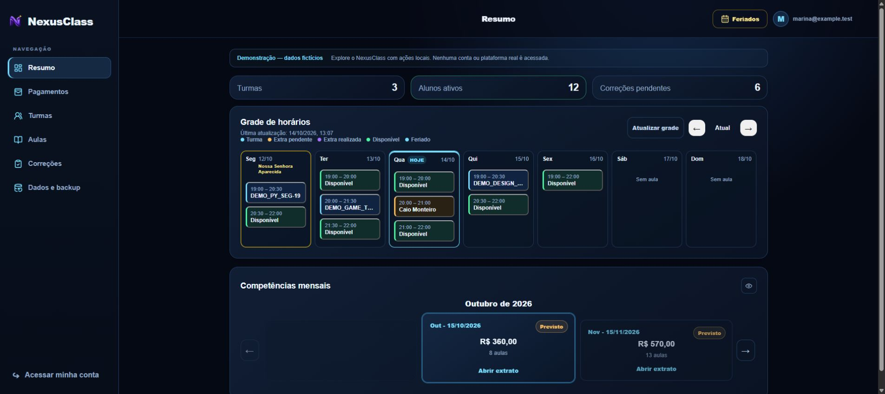

# NexusClass

Projeto de portfólio de **Ezequiel Oliveira**: gestão da rotina pedagógica e
financeira de professores, com agenda semanal, turmas, alunos, correções e
acompanhamento de pagamentos.

[Abrir o projeto](https://nexusclass.vercel.app) ·
[Experimente sem login](https://nexusclass.vercel.app/demo)

## Demonstração para visitantes

A página inicial abre a tela de entrada com o botão **Entrar como visitante**,
para compartilhar o link do projeto em um portfólio já existente. A rota
pública `/demo` também permite explorar sem login
o mesmo menu do ambiente de trabalho: **Resumo, Pagamentos, Turmas, Aulas,
Correções e Dados e backup**. A demonstração reutiliza a interface real: grade semanal, a
navegação por competências e o extrato, os alunos dentro das turmas e a
organização das pendências, usando registros fictícios.



Os dados da demo ficam apenas no navegador, em armazenamento separado das
contas reais. Não há login obrigatório, consulta à Kodland nem escrita no
Firebase nesse modo. Em **Turmas**, a demo separa as **Turmas Kodland**
fictícias das **Turmas pessoais** organizadas em grupos; ela já começa com o
grupo fictício “Turmas autônomas”. O visitante pode criar outros grupos,
alunos e turmas com vários horários, tarifa padrão ou específica e dia de
recebimento. Em
**Aulas**, pode cadastrar conteúdo, links e atividades; entregas em texto/link
aparecem em **Correções**. A grade e os pagamentos usam o mesmo cálculo da área
privada. As alterações persistem somente neste navegador; não use dados reais
na demonstração. Em **Dados e backup**, **Restaurar dados demonstrativos**
retorna ao cenário inicial.

**Tecnologias:** Next.js, React, TypeScript, Firebase Authentication,
Cloud Firestore e publicação na Vercel. A demonstração reaproveita componentes
da aplicação e o mesmo cálculo de negócio da conta privada. Adaptadores locais
separam a persistência, e operações externas ficam simuladas por segurança.

Para testar localmente: `npm install`, `npm run web:dev` e abra
`http://localhost:3000/demo`. A demonstração não precisa de credenciais Firebase
ou Kodland; elas são necessárias somente para a área privada.

## Arquitetura e histórico

O aplicativo Expo existente permanece na raiz durante a migração. A versão web
fica em `frontend` (Next.js) e usa Firebase Authentication + Cloud Firestore
diretamente no navegador; a publicação recomendada é na Vercel. A API em
`backend` (FastAPI) e o SQLite em `backend/data/aulapay.sqlite3` ficam como
legado para exportar/migrar dados, não como dependência do frontend em produção.
Consulte [docs/FIREBASE.md](docs/FIREBASE.md) para configurar o projeto.

Na conta privada, acesso continua liberado pelo administrador. O professor
pode usar turmas próprias sem credenciais Kodland; a sincronização é opcional e
afeta somente os dados da plataforma. O valor padrão por hora também vale
para turmas Kodland, mas cada turma pode ter tarifa e dia de recebimento
próprios. Edições preservam encontros anteriores, e competências marcadas como
recebidas guardam seu extrato. O backup JSON v2 inclui os cadastros próprios;
backups v1 continuam aceitos.

## Requisitos

- Docker Desktop com Docker Compose v2 (opcional)
- Node.js 24+ e npm 11+ para execução fora de containers
- Python 3.12 a 3.14 e [uv](https://docs.astral.sh/uv/) para execução local da API

## Início rápido local

1. Copie o exemplo de variáveis: `Copy-Item .env.example .env.local`
2. Preencha as variáveis `NEXT_PUBLIC_FIREBASE_*` com a configuração Web do
   Firebase.
3. Inicie o frontend: `npm run web:dev` e abra http://localhost:3000.

O backend legado ainda pode ser executado separadamente para migração e
exportação, mas não é necessário para abrir as telas web.

Para encerrar, use `docker compose down`. O banco persiste no arquivo
`backend/data/aulapay.sqlite3`; `docker compose down -v` não o remove. Não
versione, exponha como arquivo estático ou apague esse banco sem um backup.

## Execução sem Docker

Frontend:

```powershell
npm install
npm run web:dev
```

API:

```powershell
Set-Location backend
uv sync --all-groups
uv run alembic upgrade head
uv run uvicorn app.main:app --reload --port 8000
```

Para uma API local, copie `backend/.env.example` para `backend/.env`. Não é
necessário instalar ou iniciar um servidor de banco: Alembic cria o schema no
arquivo SQLite padrão. `DATABASE_URL` continua disponível como override, por
exemplo para um caminho SQLite absoluto ou PostgreSQL.

## Verificações

```powershell
docker compose config --quiet
npm run web:lint
npm run web:typecheck
Set-Location backend; uv run --isolated pytest
```

O aplicativo Expo atual continua usando os comandos existentes: `npm start` e
`npm test`.

## Contexto de dependências para o Codex

O repositório tem um índice local e regenerável dos imports estáticos de
`frontend/src`. Ele serve para reduzir a exploração em investigações que atravessam
componentes, telas e utilitários; não altera a aplicação, o deploy ou os arquivos
versionados.

Gere o índice antes de uma investigação transversal ou análise de impacto:

```powershell
npm run codex:graph:generate
```

Em seguida, consulte um arquivo pelo nome ou por uma parte específica do caminho:

```powershell
npm run codex:graph -- corrections-page.tsx
npm run codex:graph -- src/components/corrections-page.tsx
```

A consulta mostra as dependências diretas e os dependentes diretos do arquivo.
Se houver mais de um resultado, informe uma parte mais específica do caminho.
Use `npm run codex:graph -- --help` para relembrar a sintaxe.

Use o grafo apenas quando a pergunta for, por exemplo, “quais telas podem ser
afetadas por esta alteração?” ou “por onde este componente é reutilizado?”.
Para procurar textos, nomes de funções, regras de negócio ou fazer uma edição
isolada, mantenha `rg` como ferramenta principal; não há consulta ao grafo
obrigatória nesses casos.

O índice cobre somente relações de import estáticas TypeScript/TSX sob
`frontend/src`. Ele não descreve fluxos em tempo de execução, dados do Firebase,
rotas externas, chamadas de API, eventos nem regras de negócio. Como é um cache
local em `.codex/graph/` ignorado pelo Git, ele pode estar desatualizado: gere-o
novamente antes da análise e confirme as conclusões no código e nos testes.

## Operação e qualidade

`/health` confirma que a API está em execução e `/ready` também verifica o
banco SQLite. Execute todas as validações locais com `npm run quality`. O E2E
usa Chromium do Playwright: instale-o com `npx playwright install chromium` e
rode `npm run web:e2e`. Consulte [docs/OPERATIONS.md](docs/OPERATIONS.md) para
migrações, backup, restauração e limites do deploy. Para PythonAnywhere, siga
[docs/PYTHONANYWHERE.md](docs/PYTHONANYWHERE.md).
