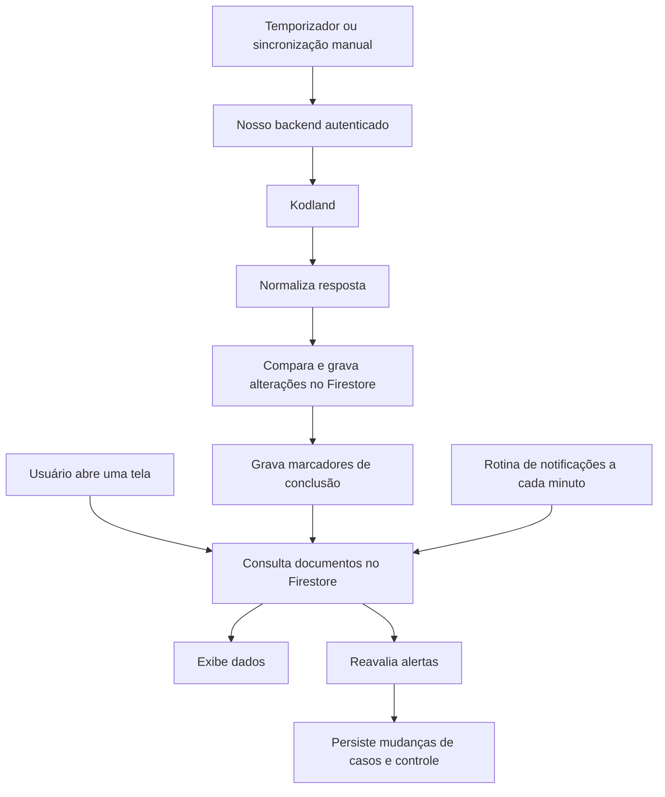
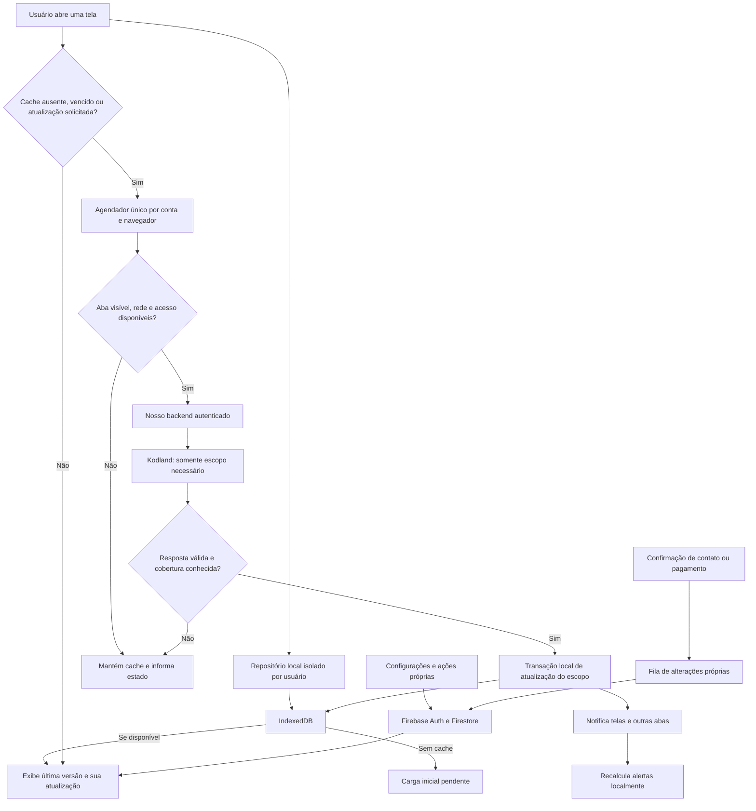

# Plano de refatoração: Kodland como fonte, IndexedDB como cache

Status: proposta de implementação, ainda não aplicada ao funcionamento da aplicação. Base: arquitetura atual em 31/10/2026, após a gravação incremental. Plano do projeto informado pelo usuário: Spark. O consumo real do Firestore e a causa definitiva da indisponibilidade ainda dependem do painel de uso.

## Objetivo e limite da substituição

Retirar do Firestore a cópia frequente das informações recuperáveis da Kodland. As telas passam a ler um repositório local por usuário; consultas à Kodland renovam esse cache conforme necessidade, sem passar por uma gravação no Firebase. Firebase Authentication, administração e persistência dos dados próprios continuam.

IndexedDB é o banco que armazena o cache no navegador. A fonte oficial dos dados importados continua sendo a Kodland. Atualização agendada/sob demanda não equivale a receber mudanças em tempo real: não há webhook ou canal de eventos da Kodland validado nesta aplicação.

A migração deve preservar tarefas e turmas próprias, notas locais, ocultação de alunos, vínculos, ajustes e confirmações financeiras, configurações e confirmações de contato. Esses dados não são substituídos por uma importação externa.

## Fluxo anterior à migração

A versão atual já compara conteúdo para evitar regravações iguais, usa lotes menores e dá prioridade à sincronização manual. Ainda assim, os dados importados passam pelo Firestore, os marcadores são escritos, e a avaliação de notificações pode reler as coleções a cada minuto.

Antes das correções incrementais, registros iguais também eram regravados. O consumo de um projeto é compartilhado entre usuários. Reduzir gravações não restaura uma quota já consumida e não elimina as leituras recorrentes.

## Fluxo proposto

Uma atualização de uma turma não substitui dados de outras turmas. Uma resposta parcial não autoriza apagar o restante de um módulo ou histórico. A ausência de uma atividade em uma página de resultado não prova entrega.

## Onde cada informação fica

| Informação | Fonte e persistência propostas |
|---|---|
| Login e identidade | Firebase Authentication; nenhuma senha em documentos comuns |
| Administração, permissões e bloqueios | Backend atual e Firebase; ações privilegiadas exigem validação online |
| Preferências e regras de notificações | Firestore, com cópia local; atualizar ao entrar/salvar e por evento ou listener restrito ao documento |
| Turmas, alunos e contatos importados | Kodland → IndexedDB |
| Agenda, presença, atividades, revisões e extras importados | Kodland → IndexedDB |
| Catálogo e materiais importados | Metadados e links no IndexedDB; não copiar vídeos ou arquivos grandes |
| Folha oficial consultada | Cache local; confirmar separadamente que o histórico necessário permanece consultável |
| Ajustes financeiros e pagamentos confirmados pelo usuário | Firestore, com retrato necessário para manter o comprovante histórico |
| Turmas, cursos, atividades e tarefas próprias | Persistência remota atual, com cache/fila local quando aplicável |
| Notas, ocultação de alunos, vínculos e preferências de turma | Firestore em documentos próprios; não dentro de registros descartáveis importados |
| Alertas derivados de presença/atividades | Calcular e guardar localmente |
| Leitura/contato confirmado pelo usuário | Ação própria remota, por identificador estável e revisão; sem reconciliar todo o histórico no Firestore a cada minuto |
| Diagnóstico | Resumo técnico local e logs de backend; persistência remota amostrada de falhas importantes, sem gravar cada consulta bem-sucedida |

O cache importado pode ser reconstruído. O mesmo não se aplica automaticamente aos dados próprios. Em outro aparelho haverá uma nova carga Kodland; IndexedDB não compartilha dados entre aparelhos.

## Política inicial de atualização

Estes são parâmetros iniciais a validar com o volume e os endpoints reais, não novos intervalos já publicados. Todos os prazos significam elegibilidade para consulta quando a aplicação estiver ativa, não um job que funciona com o navegador fechado.

| Conjunto | Consulta inicial e renovação propostas | Escopo e prioridade |
|---|---|---|
| Turmas e alunos | Primeira abertura sem cache; depois TTL de 24 h ou atualização manual | Lista autorizada e turma aberta |
| Contatos dos responsáveis | Importação inicial; depois TTL de 7 dias; sob demanda se faltar número ou usuário solicitar | Aluno/turma necessários; não consultar a cada mensagem |
| Catálogo de cursos | Ao abrir sem cache; TTL de 7 dias ou troca de curso | Curso necessário |
| Materiais | Ao abrir uma aula sem material válido; TTL de 7 dias; revalidar link com falha | Somente aula aberta, metadados e links |
| Agenda | Ao abrir com cache vencido; TTL inicial de 1 h | Turmas relevantes e janela de datas necessária |
| Presença | Após aula: elegível em +5 e +30 min; ao abrir presença vencida ou por solicitação | Aula/turma recentes; sem varrer todos os meses |
| Atividades recentes e pendências | Após aula; em Acompanhamento ativo, elegibilidade de 15 min para a turma aberta; fora dele, 60 min quando necessário | Módulo atual e pendências antigas ainda abertas |
| Atividades antigas concluídas | TTL de 7 dias ou atualização manual | Não participam de cada rodada recente |
| Extras pendentes | Ao abrir agenda/extras; TTL de 30 min | Pendentes e período relevante |
| Disponibilidade importada | Ao abrir com cache vencido; TTL de 6 h | Período relevante |
| Pagamentos oficiais em aberto | Ao abrir com cache vencido; TTL inicial de 6 h ou atualização manual | Competência escolhida |
| Competências antigas | TTL de 7 dias ou atualização manual | Competência escolhida; comprovantes próprios permanecem remotos |
| Notificações | Ao atualizar dados locais ou vencer uma tolerância/prazo | Avaliação local; relógio de 1 min não faz consultas Firebase/Kodland |

Voltar da correção de uma atividade pode revalidar a turma pertinente, com espaçamento mínimo e reaproveitamento de consulta em andamento. Abrir WhatsApp não confirma que uma mensagem foi enviada nem que a atividade foi entregue.

Para recuperar alterações antigas fora da janela recente, reservar uma revisão mais ampla diária enquanto a aplicação estiver ativa, em lotes e com orçamento. A atualização manual pode ampliar o escopo sem apagar o cache durante a consulta.

## Repositório e esquema local

Criar uma interface `KodlandRepository`, usada por telas, dashboard, pagamentos e fonte de notificações. Inicialmente ela terá adaptadores Firestore e IndexedDB para permitir migração por conjunto. Componentes não devem chamar IndexedDB ou as coleções importadas diretamente.

Stores propostas:

- `groups`, `students`, `guardianContacts`, `courses`, `lessons`, `attendance`, `taskProgress`, `reviews`, `extras`, `availability` e `payroll` para dados importados normalizados.
- `syncScopes` para versão de esquema, UID, origem, escopo, horários, validade, cobertura, páginas concluídas, revisão/hash e resultado da última tentativa.
- `notificationCases` para casos derivados e revisões locais.
- `ownDataCache` e `ownOutbox` separados do cache descartável, se necessários para os dados próprios.

Chaves incluem UID e identificadores de origem/turma/aluno/aula conforme a entidade. Cada leitura e conclusão assíncrona valida a conta atual. Trocar usuário nunca pode exibir o cache da conta anterior.

Gravar o escopo em uma transação local. Só publicar uma nova versão completa quando a cobertura exigida estiver validada. Atualizações parciais autorizadas preservam os registros fora do escopo; falhas mantêm a última versão utilizável e não atualizam `lastSuccessAt`.

TTL vence a elegibilidade do dado, não o apaga. Falha de rede não deve transformar uma lista conhecida em vazia. Manter a data da última atualização e distinguir falta de cache, dados antigos, erro de consulta e resposta realmente vazia.

Usar índices por UID, turma, aluno, aula, data e estado para evitar varrer todo o banco local. Limitar o histórico ao necessário e remover dados reconstruíveis antigos sob pressão de armazenamento. Medir ocupação com Storage API e tratar `QuotaExceededError`; pedidos de persistência do navegador não são garantia de retenção. Cache em memória serve de contingência com aviso, sem afirmar salvamento persistente quando IndexedDB estiver indisponível.

## Agendador e backend

Um coordenador por UID calcula escopos vencidos, prioriza ações manuais e compartilha consultas em andamento. Web Locks e BroadcastChannel evitam duplicação entre abas. Sem esses recursos, aplicar coordenação local e expor a limitação; aparelhos diferentes ainda podem consultar separadamente.

Deduplicação entre aparelhos exigiria um cache compartilhado no backend, isolado por UID e com TTL. Isso é uma evolução opcional; memória de função Vercel não é cache compartilhado confiável e não deve ser tratada como tal.

O backend continua validando Firebase ID token, revogação e autorização Kodland. Normaliza uma resposta somente de leitura, com escopo e cobertura explícitos. Não expor um proxy de URLs arbitrárias, compartilhar cache entre professores ou gravar credenciais/tokens junto aos dados importados. Reutilizar o cofre/autenticação existente sem misturar seu ciclo de vida ao cache de consultas.

O orçamento deve contar chamadas externas à Kodland, além de chamadas ao nosso endpoint. Uma requisição nossa atualmente pode percorrer muitas aulas. Para presença/progresso, particionar a consulta por turma e aulas/módulos antes de consultar cada progresso; validar quais filtros existem na API e aplicar seleção local do catálogo quando necessário, sem inventar suporte do provedor.

Começar com uma atualização por navegador/conta, concorrência externa pequena e configurável, espaçamento, jitter, backoff e respeito a `Retry-After`. Manter orçamento de tempo por chamada e cancelamento antes de iniciar etapas novas. Nunca iniciar outra importação apenas porque a interface desistiu de esperar uma anterior ainda ativa.

## Notificações e consistência

`normalizeNotificationSource` passa a receber o snapshot do repositório local, mantendo as regras puras atuais. `StudentNotificationsProvider` escuta mudanças locais e prazos: remove a rotina que recarrega todas as coleções a cada minuto.

Separar estado derivado de entrega/presença das ações próprias de leitura e contato. Confirmação de contato remoto não prova entrega. Identidade e revisão estáveis evitam duplicar alertas entre atualizações e permitem consultar ações compartilhadas ao abrir a central, sem reler tudo periodicamente.

Dado desconhecido, histórico incompleto e cache vencido não podem produzir cobrança indevida nem regularização falsa. Só encerrar um caso quando a atualização autoritativa cobrir as obrigações pertinentes. Ao renovar uma turma, reavaliar seus casos; não reconciliar todas as turmas na rede.

## Migração em fases

1. **Medir e classificar.** Registrar contagens técnicas por escopo, chamadas Kodland e acessos Firestore. Confirmar uso/quota do projeto. Inventariar todos os consumidores e campos locais misturados às coleções importadas.
2. **Introduzir o repositório.** Interfaces, esquema IndexedDB versionado, separação por UID, contratos de cobertura e adaptadores. Sem mudar a fonte principal ainda.
3. **Migrar leitura de Atividades e Presença.** Cache local como leitura principal desses conjuntos, atualização Kodland → IndexedDB, sem espelhamento Firestore para usuários habilitados na migração. Validar comparações com fixtures e contas piloto, sem duplicar gravações em cada atualização.
4. **Migrar notificações.** Fonte local, avaliação por evento/prazo e persistência remota apenas das ações próprias. Remover releituras globais de 1 min.
5. **Migrar demais dados importados.** Agenda, turmas, alunos, contatos, cursos, materiais, extras e folha consultada. Dashboard e pagamentos calculam a partir do repositório mais os ajustes próprios remotos.
6. **Separar overlays próprios e backup.** Extrair notas, vínculos, ocultação, ajustes e confirmações de documentos importados para documentos próprios idempotentes. Manter backup/exportação JSON versionados e importação de versões anteriores. Migrar antes de qualquer exclusão.
7. **Desativar a arquitetura antiga.** Feature flag por conta/conjunto, piloto e expansão gradual. Só remover coleções antigas após validar consumidores, backup, retenção e rollback. Nenhuma exclusão de produção faz parte deste plano.

A primeira experiência não deve depender de ler o espelho completo do Firestore: pode reconstruir o cache diretamente da Kodland em escopos. Se usar dados legados para acelerar a migração, copiar uma vez, marcar como antigos e revalidar. Um navegador novo repete a carga inicial, sem simular que recebeu cache de outro aparelho.

Na interface, distinguir atualizar dados da Kodland, limpar cache deste aparelho e apagar dados próprios. Limpar cache não executa reset remoto. Backup mensal em JSON pode ser uma opção separada; agendamento garantido com a aplicação fechada exige um serviço no backend, não um temporizador de navegador. Não incluir senhas/tokens nas exportações.

O rollback reativa o adaptador antigo para os conjuntos ainda preservados; dados remotos antigos precisam ser revalidados, pois o espelho deixa de ser atualizado após a mudança. Nunca apresentar o espelho congelado como recente.

## Segurança, limpeza e autonomia

Importações são reconstruíveis; tarefas próprias, comprovantes e ações do usuário não são. Limpar cache importado ao sair/trocar conta conforme a política do produto, sem apagar silenciosamente uma fila de alterações próprias ainda não enviada. Exportação/limpeza integral deve considerar essas pendências.

IndexedDB não é um cofre seguro contra JavaScript da mesma origem. Não colocar senhas/tokens nos registros de cache, limitar dados sensíveis e aplicar controles já existentes de sessão. Bloqueios de acesso são verificados online; não há revogação instantânea de dados que já foram baixados para um aparelho offline.

Ter dados no IndexedDB não torna sozinho o site uma PWA offline. Abrir a aplicação do zero sem rede exige cache do shell/assets por service worker, que deve ser uma etapa separada. A fase base permite usar dados locais com o shell já disponível e durante indisponibilidade de Kodland/Firestore, dentro das permissões da sessão.

## Critérios de aceite e métricas

- Uma atualização periódica de dados importados não lê nem escreve coleções `kodland_*` no Firestore; login, preferências e ações próprias têm medição separada.
- Avaliar notificações por 1 h sem mudança local não provoca recarga remota do histórico nem gravações de reconciliação.
- Duas abas da mesma conta pedindo o mesmo escopo compartilham uma execução; contas diferentes não compartilham dados ou resultados.
- Resposta parcial/falha não apaga o cache válido, não encerra alertas sem prova e não grava sucesso falso.
- Novo aparelho, cache vazio, falta de espaço, IndexedDB bloqueado e migração de versão têm comportamento explícito.
- Ajustes próprios, snapshots financeiros confirmados e ações pendentes sobrevivem à migração e ao rollback.
- Testar relógio, TTL, aula recém-encerrada, retorno de foco, modo oculto/offline, falha parcial, conta trocada e escopos de turma/módulo.
- Medir por sessão: leituras/escritas Firestore, chamadas ao nosso backend e à Kodland, acertos de cache, duração e tamanho do cache. Comparar com a linha de base real, não somente projeções.

Metas operacionais iniciais: nenhuma persistência do espelho Kodland durante atualização automática; nenhuma releitura global de 1 min para alertas; uma consulta por escopo vencido entre abas; nenhum dado próprio perdido. Definir metas de latência e limites de chamadas por usuário a partir das medições do piloto, sem prometer valores antes de medir.

## Pontos de código a alterar

- `frontend/src/lib/api.ts`: separar consulta Kodland, repositório importado e persistência própria; consumidores atuais de `kodlandApi`, dashboard, pagamentos e backups.
- `frontend/src/components/use-kodland-auto-sync.ts` e `frontend/src/lib/kodland-auto-sync.ts`: substituir intervalos globais por política de escopos/janelas.
- `frontend/src/lib/kodland-sync-lock.ts`: reutilizar prioridade manual, estender coordenação e notificações entre abas para o repositório.
- `frontend/src/lib/student-notification-source.ts`, `student-notification-store.ts` e `frontend/src/components/student-notifications.tsx`: snapshot local, alertas derivados e ações remotas separadas.
- `frontend/src/app/api/kodland/sync/route.ts`: respostas normalizadas e particionadas, cobertura, validação e orçamento externo; manter autorização e referências.
- `frontend/src/lib/browser-credentials.ts`: preservar isolamento do cofre, sem misturar credenciais ao cache importado.
- `frontend/src/lib/release-notes.ts` e documentação: anunciar apenas cada fase entregue e validada.
